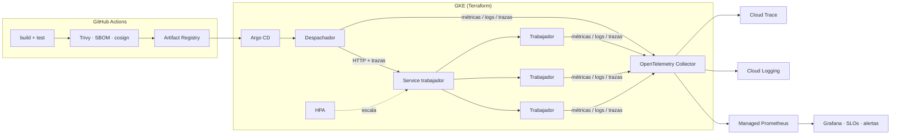

# filtros-platform

Evolución a nivel de producción del
[servicio paralelo de procesamiento de imágenes](https://github.com/Slylem0/infra-2026-2-proyecto-filtros)
(proyecto final de Infraestructuras Paralelas y Distribuidas, Univalle 2026-II).

El proyecto del curso es el **MVP**: motor C++/OpenMP, trabajador HTTP,
despachador y despliegue en GKE. Este repositorio lo lleva a cómo se operaría en
la industria: **infraestructura como código, observabilidad completa, SLOs y
alertas, autoscaling, GitOps, seguridad de la cadena de suministro y control de
costos**.

## Arquitectura objetivo

## Roadmap

| Versión | Tema | Qué se gana |
|---|---|---|
| **v0 · Fundación** | Importar el MVP, Terraform, entornos dev/prod | Infra reproducible desde cero con un comando |
| **v1 · Observable** | Métricas, logs estructurados, trazas, dashboards | Saber qué pasa dentro del servicio |
| **v2 · Confiable** | SLOs, alertas, runbooks, HPA, resiliencia | Que aguante carga y avise antes de fallar |
| **v3 · Entrega segura** | GitOps con Argo CD, canary, escaneo y firma de imágenes | Desplegar seguido sin miedo |
| **v4 · FinOps** | Costos por servicio, apagado automático, rendimiento | Gastar el crédito con criterio |

El detalle está en el tablero del proyecto y en los issues agrupados por épica.

## Equipo

| Integrante | Enfoque |
|---|---|
| Pablo ([@Slylem0](https://github.com/Slylem0)) | Plataforma, nube, IaC, observabilidad |
| Kevin ([@Kesrigo01](https://github.com/Kesrigo01)) | Instrumentación de la app, pruebas de carga, resiliencia |

## Cómo trabajamos

Ver [CONTRIBUTING.md](CONTRIBUTING.md). Las decisiones de arquitectura se
registran como ADR en [`docs/adr/`](docs/adr/).
